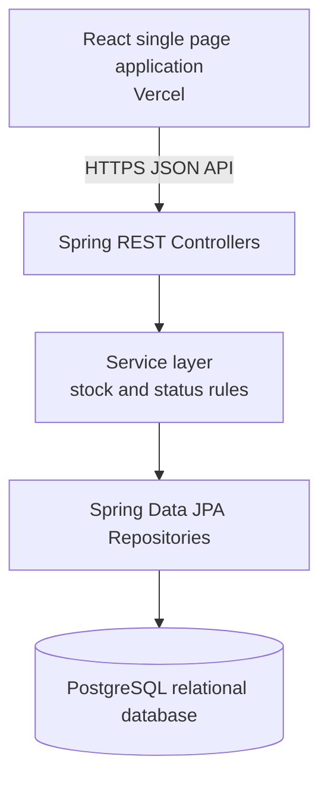

# Architecture

The API is an independently deployable service boundary. The React UI calls only `/api` endpoints; it does not access the database. Controllers validate HTTP input and return JSON, services enforce business rules, and repositories persist the entities with JPA. This directly follows the supplied Controller, Service, Repository, Database architecture.

## Presentation walkthrough

1. React routes provide Dashboard, Products, Orders, New Order, and Low Stock views.
2. Controllers accept requests and delegate to services.
3. `OrderService` checks stock before deducting it; deleting a pending order restores it.
4. JPA maps the relational model and performs CRUD through repository interfaces.
