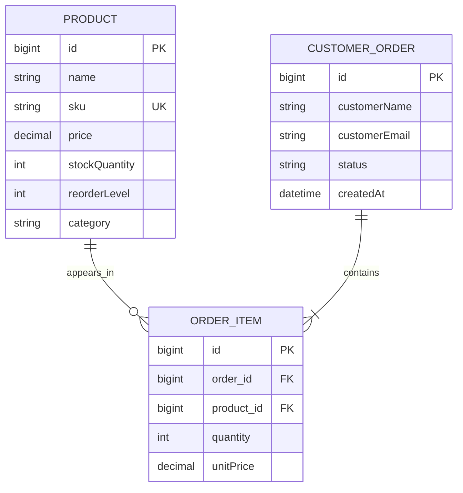

# Entity relationship diagram

`ORDER_ITEM` is the related join entity: an order has one or more items and a product can appear in many order items. `unitPrice` is captured at order time so later product price changes do not alter historic orders.
